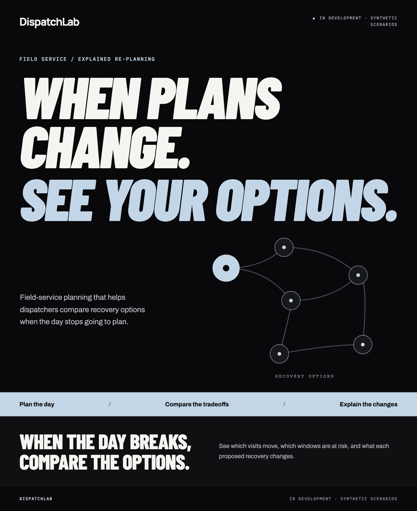
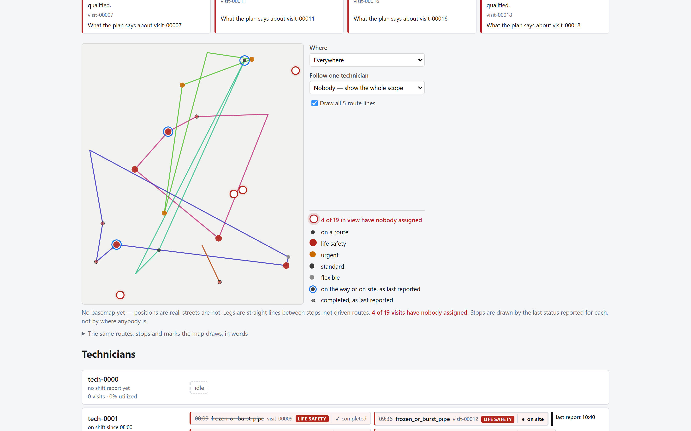
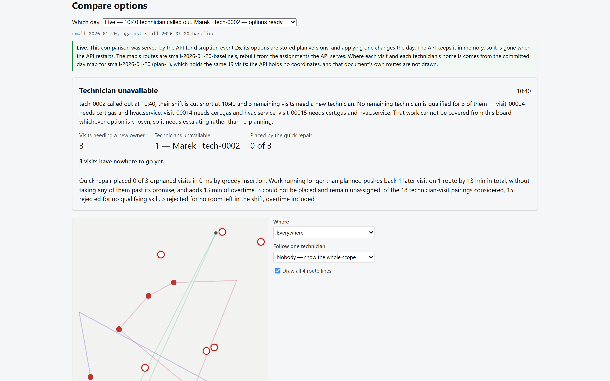
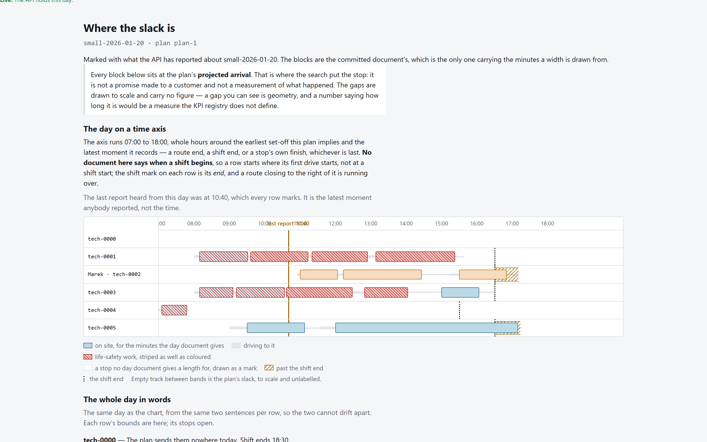
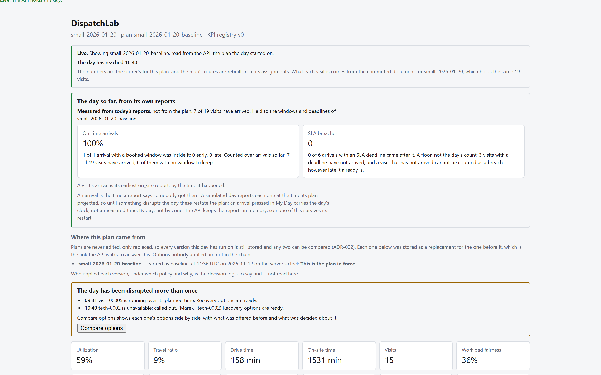
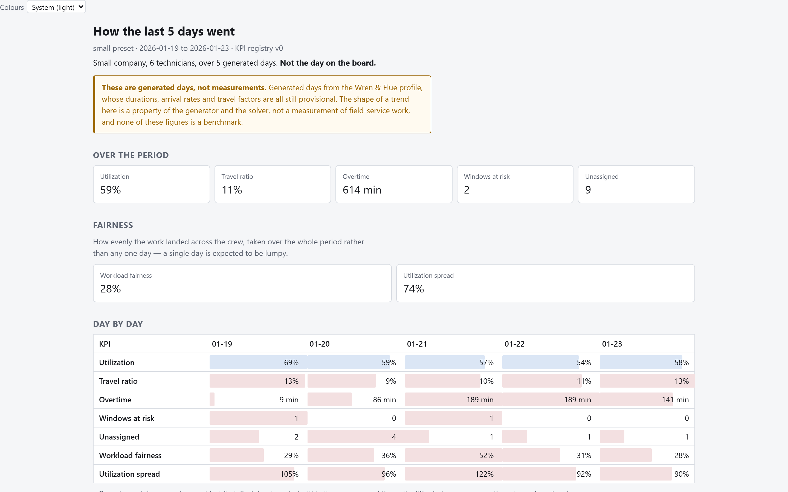
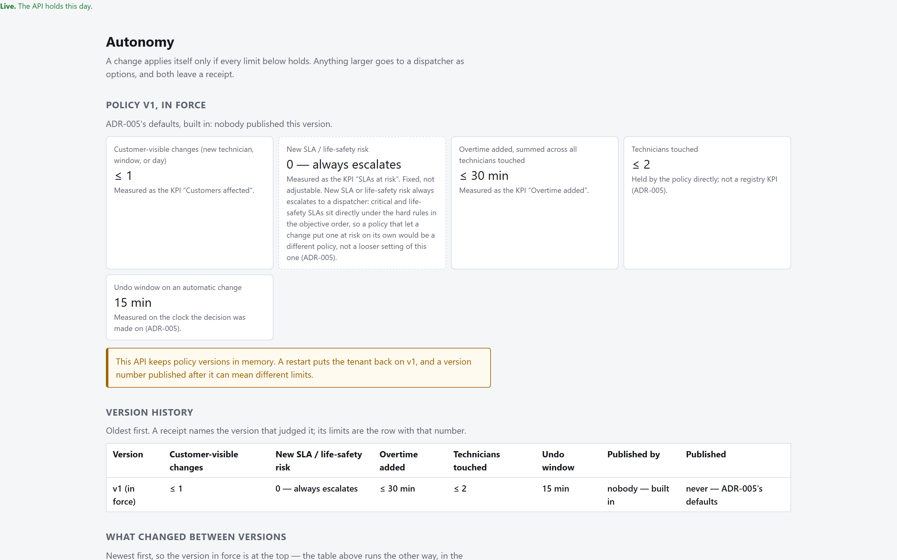
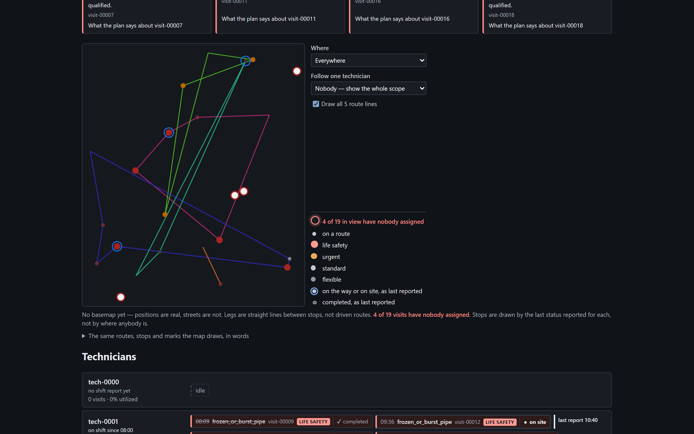
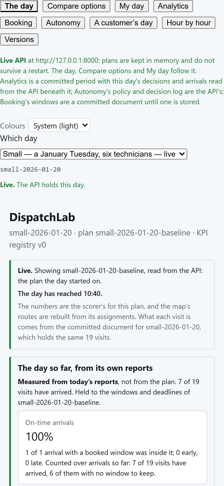

# DispatchLab

**Field-service scheduling that re-plans when the day breaks — and explains every option before anybody commits to one.**

A technician calls out at 10:40 with five visits left, three of them needing a
certification only they hold. A boiler replacement overruns by forty minutes
and pushes back everything behind it. An emergency comes in at 13:05, after the
routes are already driving.

Optimisers answer *"here is the new plan."* A dispatcher needs the question
before that one: **what can move, what must stay protected, and what does each
recovery cost the rest of the day?**

> This is a portfolio showcase. **The source is in a private repository** — see
> [Seeing more](#seeing-more). Everything below is the working application,
> screenshotted against a live API with a day in progress. All data is
> synthetic: a fictional HVAC/plumbing company in Chicagoland, generated from
> one profile.

---

## The day, as a dispatcher sees it

The board reads a day that is **actually running** — it has reached 10:40, seven
of nineteen visits have arrived, and two disruptions have been reported and
answered. Routes are drawn from the plan the API says is current, and each stop
carries the last status reported for it.

Nothing on this screen is a number the page invented. Every figure comes from a
shared KPI registry that the scorer and the analytics models both compute from,
and a number shown in the app that is not in that registry is treated as a bug.

---

## When it breaks, you get options — not an answer

A disruption yields **two to four complete recovery plans**, each built around a
different priority — protect promises, fewest customer changes, least overtime,
least travel, balanced workload. Plans that another plan beats on every measure
are filtered out, so what reaches the screen is a real tradeoff.

Each option carries:

- **a diff** — which visits move, to whom, and by how much
- **a why-not** — why *this* technician was not chosen, blocking reason first
- **a receipt** — what changed, which rule allowed it, and how to undo it
- **customer impact as a headline number**, never a hidden engine setting

And when the honest answer is that no plan works, it says so in those terms.
Above: three visits need a gas certification that the only holder took home with
them, so the quick repair placed **0 of 3** and the sentence says the work *"cannot
be covered from this board whichever option is chosen, so it needs escalating
rather than re-planning."*

---

## Where the slack actually is

A list of stops cannot show you a gap. This view answers *"where is the slack in
this day"* **by geometry rather than by a figure** — a block's width is minutes,
so the empty space between two blocks is the answer, and no tooltip has to claim
"42 min idle".

---

## One change, three points of view

<table>
<tr>
<td width="50%">

**The technician** sees their own route, what is next, and the booked window and
response-time promise attached to it — stated as facts, never as a verdict. The
page holds no clock, so it will not tell somebody they are late.

</td>
<td width="50%">

**The manager** sees what each disruption cost, which recovery strategy was
applied, and where one more technician would pay for themselves — the last from
a simulation, with the answer written in sentences before the evidence.

</td>
</tr>
</table>

There is a customer's view too: every notice the system drafted for them, in the
API's own words, with replacements made explicit — *"this replaces our earlier
message"* — and a note when a change was withheld because what they already know
is still true.

---

## Autonomy, with receipts

Small fixes apply themselves. Anything bigger escalates.

A tenant's policy sets the limits — customer-visible changes, new SLA risk,
overtime added, technicians touched, undo window — and **every limit must hold**
for a change to apply on its own. The policy is versioned, so a receipt written
three weeks ago is still explainable under the policy that allowed it. Pausing
automation is not a flag: it is a published policy version with its gating
limits at zero, which keeps the audit trail honest.

Every automatic change writes a receipt showing which limits held and by how
much, who it affected, and whether it can still be undone.

---

## It also runs in the dark

Both themes, following the operating system or an explicit choice. Every colour
is computed rather than eyeballed: a tree-wide gate walks every view in **both**
themes and measures the composited contrast of every piece of text — through
each translucent layer, as a reader actually sees it.

And it fits a phone, which a gate holds every view to at 390px.

---

## What is actually built

| | |
|---|---|
| **Domain model** | Pydantic models and published JSON Schemas as the source of truth; the web's types are generated from them and from the API's own OpenAPI document, so a contract change that is not regenerated fails rather than drifts |
| **Planner** | OR-Tools behind a solver-agnostic adapter; a six-step disruption pipeline — freeze, cut short, quick repair (< 1 s), re-optimise the neighbourhood, filter by Pareto dominance, score and diff |
| **Scoring** | Our own scorer, differ and counterfactuals, deliberately independent of the solver, with KPIs always recomputed from a plan's assignments and never read from the solver's output |
| **API** | FastAPI with 28 operations, server-sent events for the live day, append-only bi-temporal event log, immutable versioned plans |
| **Web** | React + TypeScript, MapLibre GL, nine views, a command palette, and a live day driven entirely by the event stream |
| **Analytics** | dbt models over a shared KPI registry, with a contract test that builds every mart in DuckDB and compares it KPI-by-KPI against the Python scorer |
| **Simulator** | A seeded day generator and a clock that plays a day at 10–60×, talking to the product **only through its public API**, so nothing downstream can tell a simulated event from a real one |

### Architectural decisions it is built on

- **Plans are immutable and versioned.** Nothing is ever edited — only replaced
  — so any two versions can be diffed or replayed, and an undo is a
  *compensating version* rather than a document put back.
- **Objective priority is fixed at the top.** Safety, skills and pinned visits
  are hard constraints; strategies re-weight only what comes after.
- **Explanations are built from the scored plan**, so they cannot invent a
  reason. Templates are the product.
- **One KPI registry, two consumers**, held together by an executed test rather
  than a convention.

---

## How it is tested

Roughly **5,900 automated checks**, and the interesting ones are not the count:

- **Property tests over the scorer and differ**, generated rather than written,
  including that reordering a plan's rows must not change anything the scorer
  *says* — justifications included. It found a live order-dependence on its
  first run.
- **A cross-language contract test** that builds the dbt marts for real in
  DuckDB and compares them against the Python scorer KPI by KPI, with an
  emptiness check first so two empty results cannot agree perfectly.
- **Browser tests over the whole disruption flow** — impact → options →
  compare → why-not → apply → audit — plus a second project that drives a
  **real API process** rather than stubbed responses.
- **Gates that discover their own subjects.** Six specs walk the navigation
  rather than naming views, so a tenth screen is held to the landmark,
  contrast, keyboard and phone-width rules the moment it exists.
- **Mutation sweeps.** Two of them, asking not "do the tests pass" but "which
  decisions in this code can I reverse without any test noticing?" The first
  found 93 guards nothing could see.
- **Claims sweeps.** The same question one layer up: *which sentences in this
  codebase would survive being checked?* Rules stated in a comment and held by
  nothing — a docstring forbidding what the code below it does, a test
  asserting half its own name, a count in prose about a list that has since
  grown. Several real defects came out of this, including a tie-break that
  named the wrong technician as the holder of started work.

Documentation claims are themselves gated: a check parses the project's own
reference document and holds its figures against the tree, because a count
nobody verifies is a count that goes stale in silence.

---

## What it is not

Stated plainly, because a showcase that only lists what works is not worth
trusting:

- **Not deployed.** It runs locally, end to end, with one command. The container
  stack is written and has never been built here.
- **Not calibrated.** Every generated day is synthetic. The job durations,
  arrival rates and travel factors are plausible placeholders, explicitly marked
  as provisional. **No number this app shows is a measurement of anything real.**
- **Not durable.** The live loop runs on an in-memory store. The Postgres path
  exists for plans and is deliberately unimplemented for the rest, rather than
  quietly replaced with whatever was easy to verify.
- **No identity provider**, no billing, no signup, no real GPS, and notifications
  are drafted and shown in a feed rather than sent.

It is a showcase built so that it *could* become a product — and the boundary
between the two is documented rather than blurred.

---

## Seeing more

The source lives in a private repository. I am happy to:

- **walk through the running application** — the whole thing starts with a
  single command, plays a scripted day against a clock, and pauses when somebody
  has to make a decision;
- **screen-share the code** and talk through any part of it — the solver
  adapter, the explanation templates, the event log, the test strategy.

Ask me for either.

---

DispatchLab is an independent project. **Wren & Flue Home Services**, its
technicians, customers and addresses are fictional. The concept renders above
and in <code>docs/concept/</code> are design direction; the screenshots in
<code>docs/screens/</code> are the running application.
